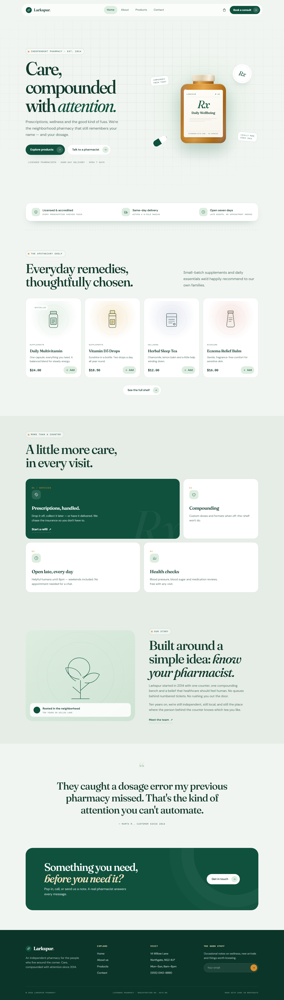
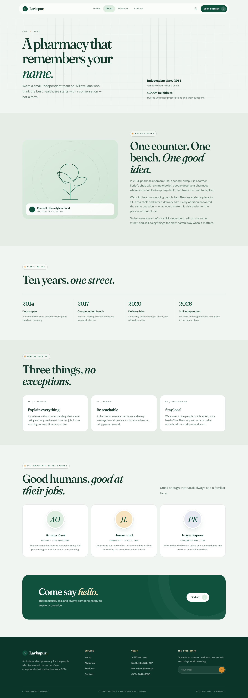
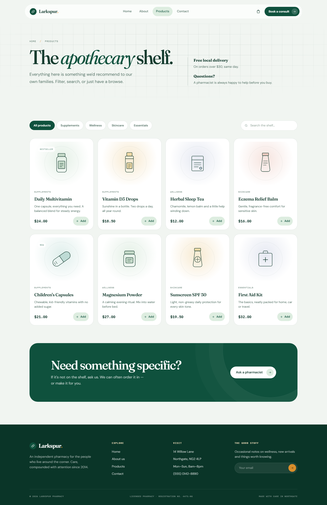
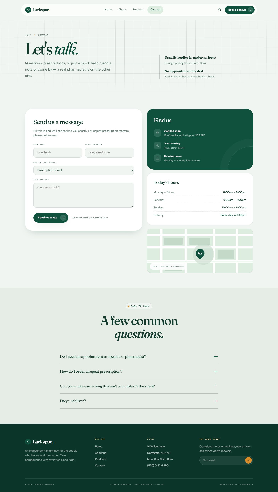

# Larkspur Pharmacy — Day 14 Coding Challenge

A four-page pharmacy website built with plain HTML, CSS and JavaScript.

## Screenshots

Full-page captures (1440px wide) of each page.

### Home


### About


### Products


### Contact


## Pages
- `index.html` — Home
- `about.html` — About (story, timeline, values, team)
- `products.html` — Products (category filters, live search, add to bag)
- `contact.html` — Contact (validated form, details, hours, map, FAQ accordion)

## Run it
Open `index.html` in any browser. No build step, no dependencies, **works fully offline**.

## Structure
```
larkspur-pharmacy/
├── screenshots/         # full-page screenshots used in this README
│   ├── 01-home.png
│   ├── 02-about.png
│   ├── 03-products.png
│   └── 04-contact.png
├── img/                 # all image files, loaded locally
│   ├── favicon.svg
│   ├── supplement.svg
│   ├── dropper.svg
│   ├── tea-box.svg
│   ├── balm.svg
│   ├── capsule.svg
│   ├── jar.svg
│   ├── sunscreen.svg
│   └── first-aid.svg
├── assets/
│   ├── css/style.css    # design tokens, layout, components, responsive rules
│   ├── fonts/           # locally hosted fonts (no Google Fonts CDN)
│   │   ├── fonts.css
│   │   └── font-*.woff2
│   └── js/script.js     # navigation, filters, search, cart, validation, FAQ, reveals
├── index.html
├── about.html
├── products.html
└── contact.html
```

All images and fonts are stored locally. The site makes **no external network requests**.
